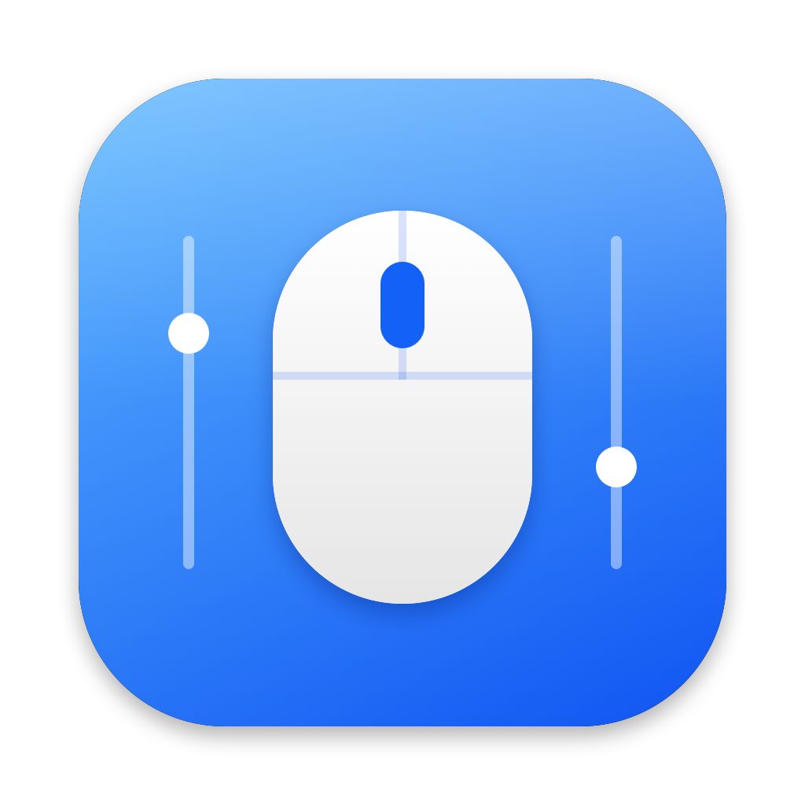

<p align="center">
  
</p>

<h1 align="center">MouseTune</h1>

A tiny, native menu bar app for macOS that gives any mouse the essentials of Logitech Options+ — without Logitech software, dependencies, network access or telemetry.

*Deutsche Version: [README.de.md](README.de.md)*

## Features
- **Pointer speed** for the mouse only (the trackpad is untouched)
- **Scroll speed** for the mouse wheel only
- **Scroll direction** (System / Natural / Classic), independent of the system "Natural scrolling" setting — mouse and trackpad can scroll differently permanently
- **Button mapping** for buttons 2–7 (middle, back, forward, …): Mission Control, Spaces, copy/paste, media keys, screenshot, and more
- Guided **onboarding**, **English / Deutsch** UI (switchable in-app), accent colors, launch at login

Requires macOS 13 or later.

## Install
### Homebrew
```bash
brew install --cask lucabartmann/tap/mousetune
```

### Manual
Download `MouseTune.zip` from the releases page, unzip, and move `MouseTune.app` to `/Applications`. Releases are ad-hoc signed, so on first launch right-click → *Open*.

## Build from source
Requires Xcode or the Command Line Tools.

```bash
./build.sh            # builds build/MouseTune.app
./build.sh --zip      # additionally creates build/MouseTune.zip
scripts/package.sh    # zip + dmg + checksums in build/dist
swift test            # runs the unit tests
```

Or open `MouseTune.xcodeproj` in Xcode and press ⌘R. Sources in `Sources/MouseTune` are picked up automatically.

Use your own certificate with `SIGN_IDENTITY="Your Name" ./build.sh`.

## Permissions
The event tap (scrolling, buttons) needs **System Settings → Privacy & Security → Accessibility**, and on some macOS versions also **Input Monitoring**. The onboarding walks you through it, and the in-app notice disappears by itself once access is granted. Pointer speed needs no permission.

An ad-hoc signature changes with every build, which makes macOS drop the permission. Remove the entry in System Settings and add the app again, or sign with a stable certificate.

## Notes
- Pointer speed only applies while MouseTune is running; the system value is restored on quit.
- Logitech's gesture button and thumb wheel use HID++ and may not show up as mouse buttons without Logitech software.
- Left and right click are never modified.

## Project layout
```
Sources/MouseTune
├── App/            entry point and app model
├── Core/           event tap, scroll maths, pointer speed, actions, config
├── Localization/   string tables (add a language here)
└── UI/             menu popover, onboarding, shared theme
Tests/MouseTuneTests
Resources/          app icon (regenerate with scripts/make-icon.sh)
```

## Releasing
Automated via GitHub Actions — see [docs/RELEASING.md](docs/RELEASING.md).

## Contributing
See [CONTRIBUTING.md](CONTRIBUTING.md). Adding a language takes one file.

## Privacy
MouseTune makes no network connections, collects no data and never logs input.

## License
[MIT](LICENSE)
